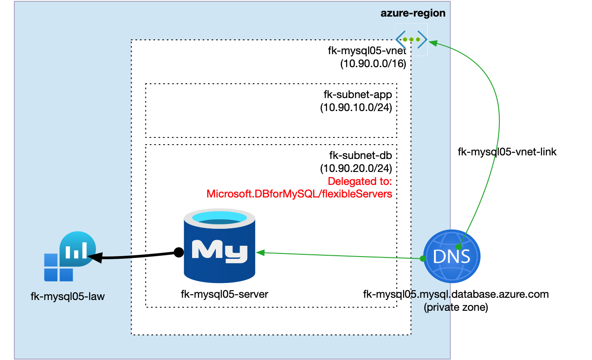
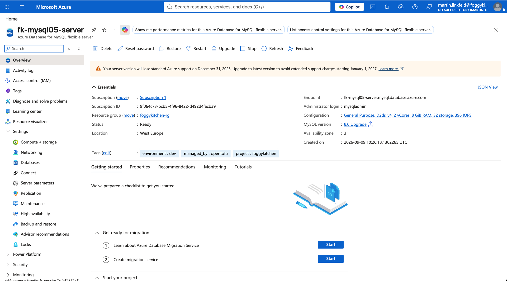
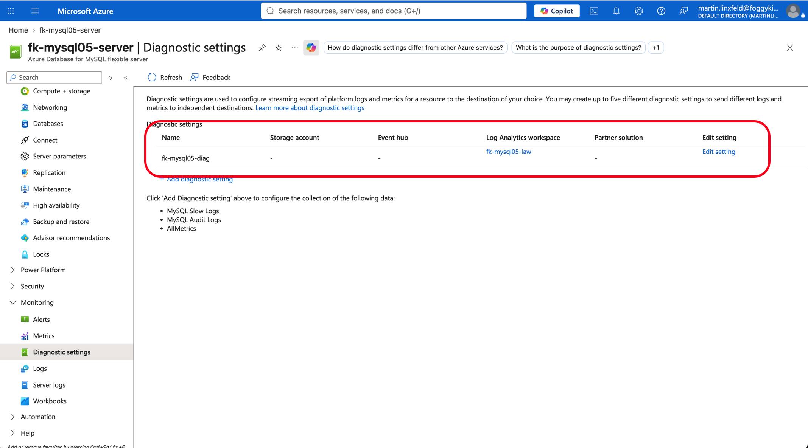
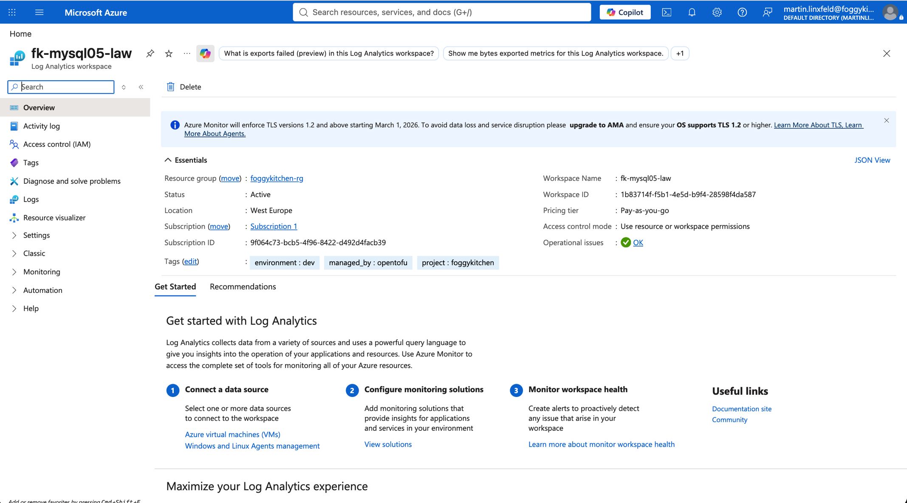
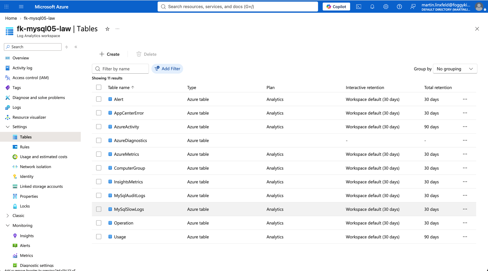
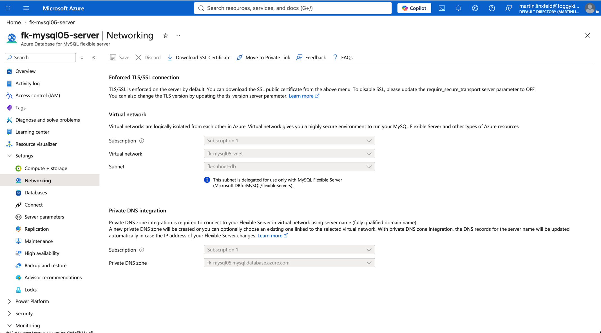
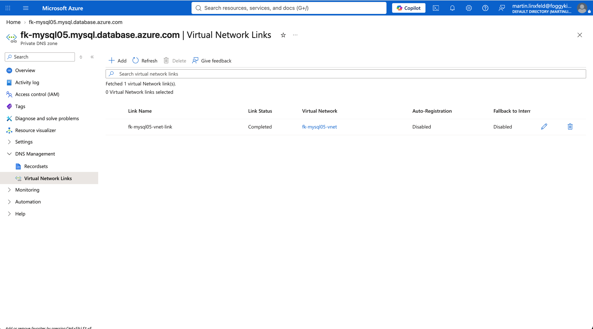

# Example 05: Diagnostic Settings

In this fifth MySQL example, we deploy an **Azure Database for MySQL Flexible Server**
using **Terraform/OpenTofu** and send MySQL platform logs and metrics to an
**Azure Log Analytics Workspace**.
The server is injected into a delegated database subnet, uses a linked Azure Private DNS Zone,
and receives an Azure Monitor diagnostic setting from the local MySQL module.

This example creates the workspace with `terraform-az-fk-log-analytics`. The MySQL module
owns the diagnostic setting so the lab demonstrates the new `diagnostic_settings` input directly.

---

## Architecture Overview



This deployment creates:

- A dedicated **Azure Resource Group**
- One **Log Analytics Workspace** using `terraform-az-fk-log-analytics`
- One **Azure VNet** using `terraform-az-fk-vnet`
- One application subnet for future client workloads
- One database subnet delegated to `Microsoft.DBforMySQL/flexibleServers`
- One **Private DNS Zone** using `terraform-az-fk-private-dns`
- One **MySQL Flexible Server** using the local `terraform-az-fk-mysql` module
- One **Azure Monitor diagnostic setting** using the `allLogs` category group and `AllMetrics`
- One sample database named `foggydb`

This example demonstrates the MySQL observability pattern where the workspace is composed
outside the database module and the MySQL module attaches diagnostics to the server.

---

## Deployment Steps

Copy the example variables file and set a strong MySQL administrator password:

```bash
cp terraform.tfvars.example terraform.tfvars
```

If you reuse a shared Azure training tfvars file, make sure it also provides
`mysql_admin_password`. Log Analytics retention and daily quota use low-cost lab defaults.

Initialize and apply the Terraform/OpenTofu configuration:

```bash
tofu init
tofu plan
tofu apply
```

After a successful deployment, OpenTofu will output:

- The MySQL Flexible Server ID
- The MySQL FQDN
- The Log Analytics Workspace ID and name
- The diagnostic setting IDs
- The created database IDs

These outputs make it easy to verify that MySQL diagnostics are attached to the expected
workspace.

---

## Runtime Notes

After deployment, the MySQL server should:

- be reachable through the delegated database subnet
- resolve through the linked Private DNS Zone
- expose the `foggydb` database
- send platform logs to the Log Analytics Workspace through `allLogs`
- send platform metrics to the Log Analytics Workspace through `AllMetrics`

Azure Monitor does not allow mixing explicit log categories and category groups in the same
diagnostic setting. This example uses the `allLogs` category group instead of enumerating each
log category.

---

## Azure Console And Runtime Verification

### MySQL Flexible Server

In the Azure portal, verify that the MySQL Flexible Server exists in the expected
resource group and region.



### Diagnostic Settings

Confirm that the MySQL Flexible Server has a diagnostic setting named `fk-mysql05-diag`
and that it targets the `fk-mysql05-law` Log Analytics Workspace.



### Log Analytics Workspace

Confirm that the Log Analytics Workspace exists and is active.



### Log Analytics Tables

Confirm that MySQL diagnostic tables are available in the Log Analytics Workspace.



### MySQL Networking

Confirm that the server is integrated with the delegated database subnet and uses private access.



### Private DNS

Confirm that the Private DNS Zone is linked to the VNet created by `terraform-az-fk-vnet`.



---

## Cleanup

To remove all resources created by this example:

```bash
tofu destroy
```

---

## Summary

This example demonstrates:

- How to enable **Azure Monitor diagnostic settings** for MySQL Flexible Server
- How to send MySQL logs and metrics to Log Analytics
- How to create a workspace with `terraform-az-fk-log-analytics`
- How to combine diagnostics with delegated subnet private access
- How to keep observability workspace concerns outside the root MySQL module

---

## Learn More

Visit [FoggyKitchen.com](https://foggykitchen.com/) for Azure, OCI, multicloud, and Terraform/OpenTofu learning resources.

---

## License

Licensed under the **Universal Permissive License (UPL), Version 1.0**.
See [LICENSE](../../LICENSE) for more details.

---

© 2026 [FoggyKitchen.com](https://foggykitchen.com) - Cloud. Code. Clarity.
